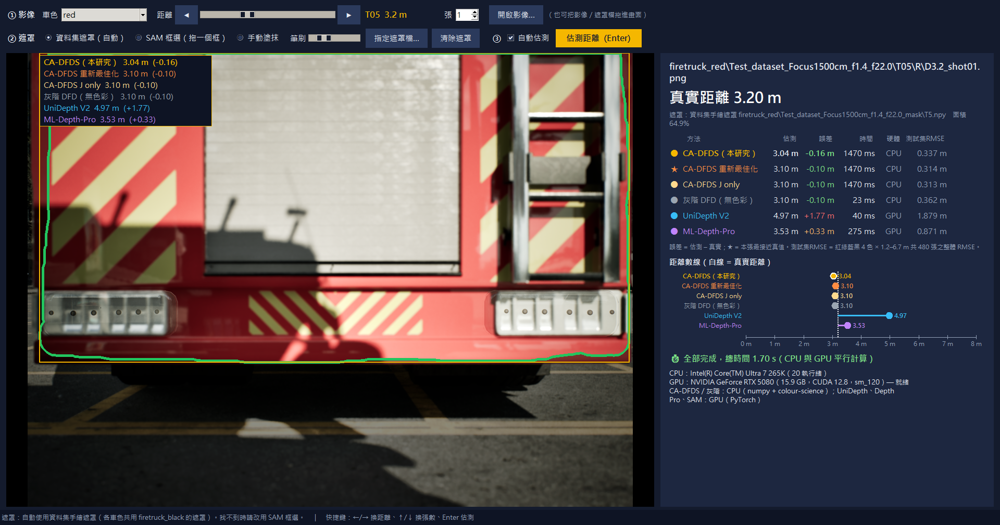

# GUI Demo（v2，2026-11-16）：方法比較介面

`gui_demo.py` 是現場展示用的介面：**同一張影像同時跑 6 種方法**，結果即時顯示在表格、距離數線和影像標籤上。

截圖：`results/gui_v2_*.png`。舊版截圖 `results/gui_1–3.png` 保留作為紀錄。



## 1. 啟動

**實驗室主機**：點兩下 repo 根目錄的 **`run_gui.bat`**。

也可以在終端機執行：

```bat
cd /d D:\Carla-0.10.0-Win64-Shipping\CA-DFDS-finals
.venv-cadfds\Scripts\python.exe gui_demo.py
```

- 視窗開啟後，右下角「GPU」那行會顯示「GPU 模型載入中…」。
  - 約 20–40 秒後變成「就緒」，這時 UniDepth、Depth Pro 和 SAM 框選才可以用。
  - 載入期間 CA-DFDS 可以先算。
- 使用兩個 Python 環境：
  - `.venv-cadfds`：跑 GUI 和 CA-DFDS。
  - `D:\Carla-0.10.0-Win64-Shipping\.venv`：有 torch 2.11 + CUDA 12.8，跑 GPU 模型。
  - GUI 會在背景自動啟動 `baselines/deep_worker.py`，不需要手動開。
  - 找不到 torch 環境時，GPU 方法顯示「未啟用」，其他功能照常。
- 可用環境變數改路徑：`CADFDS_DATA`（資料）、`CADFDS_TORCH_PY`（torch 環境的 python.exe）、`CADFDS_MODELS_DIR`（模型權重）。
- 其他參數：
  - `--no-deep`：不啟動 GPU 模型。
  - `--image <影像> [--mask <遮罩>]`：開啟時直接載入。
  - `--screenshot out.png`：算完後自動截圖並關閉，用來重現截圖。

## 2. 操作流程：① 選影像 → ② 遮罩 → ③ 估測

| 步驟 | 方式 |
|---|---|
| ① 選影像 | 上方「車色」選資料集（`red`…，或校正集 `校正-white`…），**拖曳「距離」滑桿**換距離（T01–T12），「張」換第幾張。也可以按「開啟影像…」，或**把影像檔拖進畫面**。 |
| ② 遮罩 | 三選一：**資料集遮罩（自動）**、**SAM 框選**、**手動塗抹**，說明見下方。也可以「指定遮罩檔…」（會直接開在該影像對應的遮罩資料夾），或把 `.npy` 拖進畫面。 |
| ③ 估測 | 勾選「自動估測」時，換圖或換遮罩就會自動計算；也可以按「估測距離」或 Enter。 |

遮罩的三種方式：

- **資料集遮罩（自動）**：預設。依影像位置自動找到對應的手繪遮罩，不用自己選檔。
- **SAM 框選**：在影像上按住左鍵拖一個框，把車框起來，放開後 SAM 會用 GPU 自動分割，約 0.1 秒。
- **手動塗抹**：左鍵塗、右鍵擦，「筆刷」調整大小。

快捷鍵：←/→ 換距離、↑/↓ 換張數、Enter 估測。

## 3. 畫面說明

- **影像**
  - 遮罩範圍保持原色，範圍外調暗，邊界畫綠線。
  - 黃框是遮罩外框，框旁標籤列出各方法的估測值和誤差。
- **遮罩資訊**：顯示來源與面積。使用 SAM 或手動遮罩時，會同時顯示和資料集手繪遮罩的 **IoU**，代表框出來的範圍和標準答案差多少。
- **結果表**
  - 欄位：方法、估測距離、誤差（估測 − 真實）、計算時間、使用硬體（CPU／GPU）、測試集整體 RMSE。
  - ★ 標示本張最接近真值的方法。
  - 誤差顏色：綠 < 0.2 m、橙 < 0.5 m、紅 ≥ 0.5 m。
- **距離數線**：白色虛線是真實距離，各方法的估測值是彩色圓點，連到真值的線段長度就是誤差。
- **計時**：計算中顯示即時秒數，完成後顯示總時間。CPU 與 GPU 同時計算。
- **硬體**：自動偵測 CPU 型號，以及 GPU 型號、VRAM、CUDA 版本（例如 RTX 5080、16 GB、sm_120）。換到 3060 等其他電腦時也會自動顯示。

### 方法與配色

| 顏色 | 方法 | 類別 | 說明 |
|---|---|---|---|
| 金（粗體） | CA-DFDS（本研究） | 本研究 | CIECAM02 J/a_c/b_c 權重 (0.8136, 0.1782, 0.0081) + 二次校正曲線 |
| 橙 | CA-DFDS 重新最佳化 | 本研究變體 | 式 (5) 重新最佳化權重 (0.9434, 0.0566, 0) |
| 淺金 | CA-DFDS J only | 本研究變體 | 只用明度 J |
| 灰 | 灰階 DFD | 傳統基準 | 灰階拉普拉斯清晰度，沒有色彩資訊 |
| 藍 | UniDepth V2 | 他人方法 | 單張影像深度學習模型，官方權重，不校正，取遮罩內深度中位數 |
| 紫 | ML-Depth-Pro | 他人方法 | 同上（Apple） |

暖色是本研究，冷色是他人方法，灰色是傳統基準。

## 4. 時間說明

- **CA-DFDS**：在 CPU 上算 CIECAM02，只算遮罩外框範圍，結果和整張算完全相同。
  - 近距離（車佔滿畫面）約 2.3 秒，遠距離約 0.6 秒。
  - 三種權重共用同一次 CIECAM02 計算，所以顯示的時間相同。
- **灰階 DFD**：約 20–80 ms。
- **UniDepth V2**：約 30 ms；**ML-Depth-Pro**：約 270 ms。兩者都在 RTX 5080 上，只計推論時間。
- **SAM 框選**：約 110 ms（GPU）。

## 5. 在別台電腦上執行

1. 建立 GUI 環境：`pip install -r requirements.txt tkinterdnd2`（`tkinterdnd2` 是拖放功能用的，可不裝）。
2. 若要使用 GPU 方法：另外準備一個有 torch（CUDA）、`segment_anything`、UniDepth、Depth Pro 的環境，並把 `CADFDS_TORCH_PY` 指到它的 python.exe。
   - 模型權重位置：`CADFDS_MODELS_DIR`，預設為 `...\Carla-0.10.0-Win64-Shipping\Carla-0.10.0-Win64-Shipping`。
   - 該資料夾內需要 `models/sam_vit_b_01ec64.pth`、`models_depthpro_repo/`、`models_unidepth_repo/`。
3. 影像資料不在 git 中，需要另外取得，並設定 `CADFDS_DATA`。
