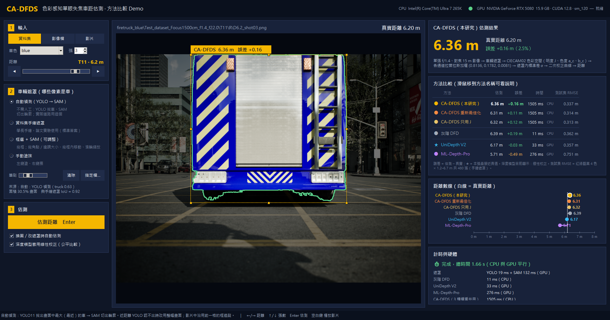

# GUI Demo：新版 v3 與學長舊版

| 版本 | 程式 | 啟動 | 內容 |
|---|---|---|---|
| **新版 v3**（2026-11-16） | `gui_new_v3.py` | 點兩下 `run_gui_new.bat` | 6 種方法同時比較、全自動遮罩（YOLO → SAM）、可調整的框、影片、硬體偵測 |
| **學長舊版** | `gui_old_senior.py` | 點兩下 `run_gui_old_senior.bat` | 學長方法（論文權重）單一方法：開啟影像 → 載入遮罩 → 估測距離。截圖：`results/gui_old_senior_1–3.png` |

- 學長舊版就是 repo 最初的 `gui_demo.py`，2026-11-16 改名保留作對照，程式邏輯沒有改。
- 以下說明都是**新版 v3**。

`gui_new_v3.py` 是現場展示用介面：

- **同一張影像（或影片每一格）同時跑 6 種方法**，結果即時顯示。
- 支援**全自動遮罩（YOLO → SAM）**、**可調整的框選**和**影片輸入**。



截圖都在 `results/` 資料夾：

| 檔案 | 內容 |
|---|---|
| `gui_new_v3_1_dataset.png` | 資料集手繪遮罩 |
| `gui_new_v3_2_auto.png` | 自動偵測：YOLO 偵測到車 |
| `gui_new_v3_3_video.png` | 影片模式 |
| `gui_new_v3_4_box_bad.png` | 框沒框好的例子：IoU 0.33，誤差變大，說明遮罩品質的影響 |
| `gui_new_v3_5_auto_near.png` | 1.7 m 近距離：YOLO 認不出，改用後備策略 |

## 1. 啟動

**實驗室主機**：點兩下 repo 根目錄的 **`run_gui_new.bat`**。

也可以在終端機執行：

```bat
cd /d D:\Carla-0.10.0-Win64-Shipping\CA-DFDS-finals
.venv-cadfds\Scripts\python.exe gui_new_v3.py
```

- 頁首右側的燈號：
  - 黃燈「模型載入中」：約 20–40 秒。這段時間 CA-DFDS 可以先算。
  - 綠燈「就緒」：YOLO、SAM、UniDepth、Depth Pro 都可以用了。
  - 紅燈：沒有 torch 環境，只能用 CA-DFDS 和灰階。
- 使用兩個 Python 環境，GUI 會自動在背景啟動 `baselines/deep_worker.py`，不需要手動開：
  - `.venv-cadfds`：GUI 與 CA-DFDS。
  - `D:\Carla-0.10.0-Win64-Shipping\.venv`：torch + CUDA，跑 GPU 模型。
- 參數：
  - `--image <影像>` 或 `--video <影片> [--frame N]`：開啟時直接載入。
  - `--mode auto|dataset|box|paint`：指定遮罩方式。
  - `--no-deep`：不啟動 GPU 模型。
  - `--screenshot out.png`：算完後自動截圖並關閉。只截 GUI 視窗本身，不會拍到其他視窗。
- 環境變數：`CADFDS_DATA`（資料）、`CADFDS_TORCH_PY`（torch 環境的 python.exe）、`CADFDS_MODELS_DIR`（模型權重）、`CADFDS_YOLO`（YOLO 權重檔名，預設 `yolo11m.pt`）。

## 2. 畫面配置

```
┌ 頁首：CA-DFDS · CPU 型號 · ● GPU 型號／VRAM／CUDA／狀態 ─────────────────────────────┐
│ 左欄（步驟）           │ 中間：影像                     │ 右欄（結果）                    │
│ ① 輸入                 │ 綠線 = 遮罩輪廓                │ CA-DFDS 估測（大字）+ 真值、誤差 │
│   資料集／影像檔／影片 │ 黃框 = 車輛框（可拖曳調整）    │ 方法比較表（6 種方法）           │
│ ② 車輛遮罩（4 種）     │ 遮罩外調暗                     │ 距離數線                         │
│ ③ 估測                 │ 框上方標籤 = CA-DFDS 結果      │ 計時與硬體                       │
└────────────────────────┴────────────────────────────────┴──────────────────────────────────┘
```

## 3. 操作流程

### ① 輸入

| 來源 | 操作 |
|---|---|
| 資料集 | 選車色（`red`…，或校正集 `校正-white`…）；**拖曳距離滑桿**換 T01–T12；「張」換第幾張。快捷鍵：←/→ 換距離，↑/↓ 換張數 |
| 影像檔 | 「開啟影像…」，或把檔案拖進畫面。沒有資料集遮罩時，自動改用「自動偵測」 |
| 影片 | 「開啟影片…」→「▶ 播放」（或空白鍵）。每處理完一格，就跳到 N 格之後的下一格（「每 N 格處理一次」）；也可以拖曳時間軸 |

測試影片：`python scripts/make_test_video.py red` 會產生 `logs/scratch/approach_red.mp4`。這是用資料集影像組成的「接近前車」序列，距離是跳躍的，不是連續運動。

### ② 車輛遮罩（哪些像素是車）

| 方式 | 說明 | 適用 |
|---|---|---|
| **自動偵測（YOLO → SAM）** | YOLO11 找出最大（最近）的車 → SAM 切出輪廓。YOLO 認不出時（< 3 m 車尾佔滿畫面），改用近距離整幅框；影片中沿用前一格的框追蹤 | **實際道路、影片**，不需人工 |
| 資料集手繪遮罩 | 學長以 `get_mask.py` 手繪，論文實驗用，可當作標準答案 | 重現論文數字 |
| 框選 ＋ SAM | 在影像上拖一個框；**拖角點或邊調大小、拖框內移動、滑鼠滾輪縮放**；調整時 SAM 即時重新分割，放開後重新估測 | 修正自動偵測的框 |
| 手動塗抹 | 左鍵塗、右鍵擦；「筆刷」調大小 | 特殊情況 |

- 在自動偵測或資料集遮罩的框上直接拖曳，會自動切換成「框選＋SAM」。
- 遮罩資訊會顯示來源（例如「YOLO 偵測（truck 0.63）」）、面積，以及**和手繪遮罩的 IoU**（1 為完全相同）。

### ③ 估測

- 「換圖／改遮罩時自動估測」：預設開啟。
- 「深度模型套用線性校正（公平比較）」：預設開啟。
  - 關閉時，顯示深度模型的原始輸出。
  - 開啟時，套用和 CA-DFDS 同一校正集擬合的線性校正。
  - 表格的「測試集 RMSE」也會跟著切換。

## 4. 結果區

- **CA-DFDS（本研究）卡片**：大字顯示估測距離、真實距離、誤差和百分比，下方有主方法的流程說明。
- **方法比較表**：

  | 分組 | 方法 | 顏色 |
  |---|---|---|
  | 本研究 | CA-DFDS（本研究，粗體） | 金色 |
  | 本研究 | CA-DFDS 重新最佳化、CA-DFDS 只用 J | 橙色、淺金色 |
  | 傳統基準 | 灰階 DFD | 灰色 |
  | 他人方法 | UniDepth V2、ML-Depth-Pro | 藍色、紫色 |

  - 只有主方法有完整說明；其他方法把**滑鼠移到名稱上**才會出現說明。
  - ★ 標示本張最接近真值的方法。誤差顏色：綠 < 0.2 m、橙 < 0.5 m、紅 ≥ 0.5 m。
- **距離數線**：白色虛線是真實距離，彩色圓點是各方法的估測值，線段長度就是誤差。
- **計時與硬體**：
  - 計算中顯示即時秒數，完成後顯示總時間。CPU 與 GPU 同時計算。
  - 分項列出：遮罩（YOLO + SAM）、CA-DFDS、灰階、UniDepth、Depth Pro。

### CA-DFDS 三個版本的差別

流程相同，只有色彩權重 (w_J, w_a, w_b) 不同：

| 版本 | 權重 (w_J, w_a, w_b) | 由來 |
|---|---|---|
| CA-DFDS（本研究） | (0.8136, 0.1782, 0.0081) | 論文採用 |
| CA-DFDS 重新最佳化 | (0.9434, 0.0566, 0) | 以現有資料重新最佳化 |
| CA-DFDS 只用 J | (1, 0, 0) | 只用明度，消融對照 |

詳見 [ARCHITECTURE.md](ARCHITECTURE.md) 第 2 節。

## 5. 時間參考（RTX 5080 + Ultra 7 265K）

| 項目 | 時間 | 說明 |
|---|---|---|
| CA-DFDS | 0.5–2.9 s（CPU） | 只算遮罩外框範圍，車越近越慢；三種權重共用同一次 CIECAM02 計算 |
| 灰階 DFD | 10–40 ms（CPU） | |
| YOLO11m | 約 13 ms（GPU） | |
| SAM | 約 105–130 ms（GPU） | |
| UniDepth V2 | 約 30 ms（GPU） | |
| ML-Depth-Pro | 約 270 ms（GPU） | |

## 6. 在別台電腦上執行

1. GUI 環境：`pip install -r requirements.txt`。`tkinterdnd2` 是拖放用的，可以不裝。
2. GPU 環境（可選）：
   - 安裝 torch（CUDA）、`ultralytics`、`segment_anything`、UniDepth、Depth Pro。
   - 把 `CADFDS_TORCH_PY` 指到該環境的 python.exe，`CADFDS_MODELS_DIR` 指到模型權重資料夾（內含 `models/yolo11m.pt`、`models/sam_vit_b_01ec64.pth`、`models_depthpro_repo/`、`models_unidepth_repo/`）。
   - RTX 3060 等其他顯卡也可以用，頁首會自動顯示型號；時間會比較長。
3. 影像資料不在 git 中，需另外取得，並設定 `CADFDS_DATA`。
