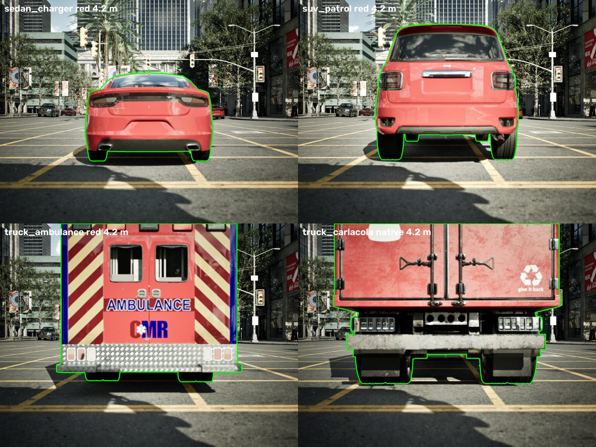
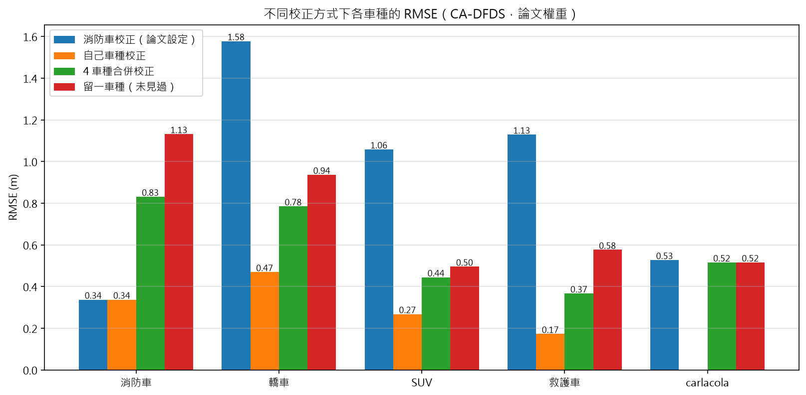
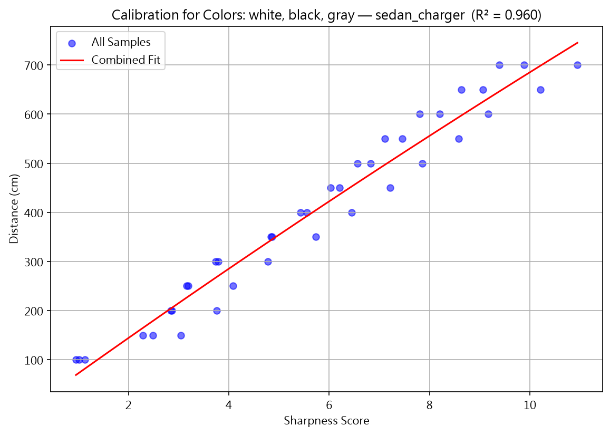
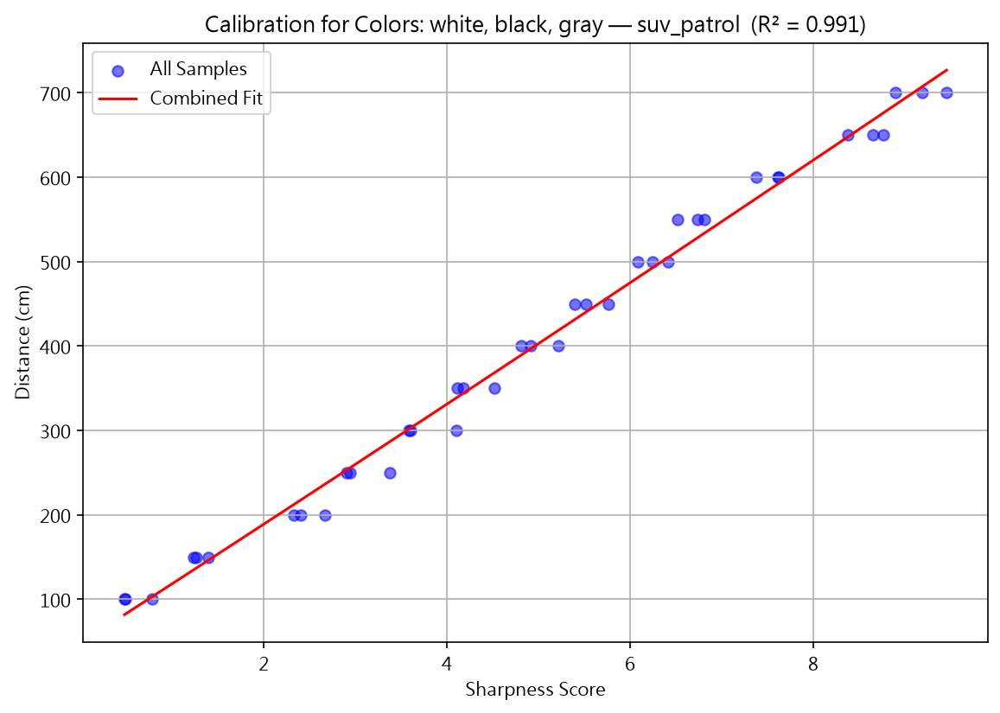
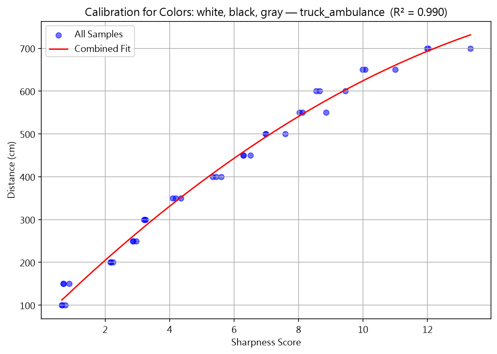
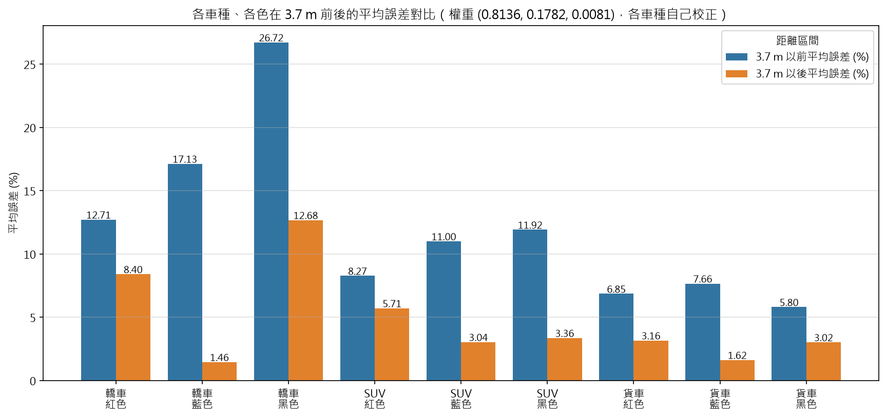

# M7 多車種測試報告（CARLA 重新產生，2026-11-16）

> 以實驗室週會投影片的格式整理。數據來源：`results/multi_vehicle_carla.csv`，以及 `results/m7_report/tables.json`。
> 投影片版（17 頁，可下載 .pptx／PDF，需擁有者分享後他人才能開啟）：https://claude.ai/artifact/FweFXJij7ewE1wwwLnEUXR
> 圖由 `scripts/m7_report.py` 產生，資料產生與評估方法見 [RESULTS.md](../RESULTS.md) 補充 R。

## 1. 實驗設定

- **相機**：CARLA 0.10、Town10HD、2048×1536、40 mm 鏡頭、對焦 15 m。
  - 光圈 f/1.4：拿來估距離。
  - 光圈 f/22：只拿來量紋理量。
- **車種**：轎車 dodge.charger、SUV nissan.patrol、貨車 ambulance.ford，另有 carlacola（原廠塗裝，不能改色）。
- **校正集**：白、黑、灰，1.0–7.0 m。
- **測試集**：紅、藍、黑，1.2–7.2 m。
- 每 0.5 m 一個距離，每個距離 10 張。
- **遮罩**：CARLA instance segmentation 自動產生，非手繪。
- **權重**：論文權重 (w_J, w_ac, w_bc) = (0.8136, 0.1782, 0.0081)。
- **清晰度與校正**：
  - Sharpness Score = sqrt(wᵀΣw)，即式 (5)。
  - 以校正集各距離的平均清晰度，擬合二次曲線 d = aS² + bS + c。
- **預測與誤差**：
  - 每張影像各自預測。表中「預測距離」為該距離 10 張預測的平均。
  - 誤差百分比 = |預測 − 實際| ÷ 實際。
  - RMSE 為逐張計算。

## 2. 不同校正方式的比較（CA-DFDS 整體 RMSE，m）

| 校正方式 | 消防車 | 轎車 | SUV | 貨車 ambulance | 貨車 carlacola |
|---|---|---|---|---|---|
| 消防車校正（論文設定） | 0.337 | 1.577 | 1.058 | 1.129 | 0.527 |
| 自己車種校正 | 0.337 | 0.469 | 0.268 | 0.173 | — |
| 4 車種合併校正 | 0.831 | 0.785 | 0.444 | 0.367 | 0.516 |
| 留一車種（未見過的車種） | 1.132 | 0.936 | 0.495 | 0.576 | 0.516 |

- 消防車的校正曲線**不能直接套到其他車種**：會一律高估 0.4–1.3 m。
- 用自己車種的校正，誤差回到 0.15–0.65 m。
- 把車種混合校正，或拿去量沒見過的車種，誤差介於兩者之間。

## 3. 各車種校正曲線與測試結果（自己車種校正）

### 轎車（dodge.charger）

校正 R² = 0.9599，係數（cm）a, b, c = -0.482, 73.396, -0.721。

#### f/1.4、焦距 15 m 之紅色車子測試結果

| 原始距離 (m) | 預測距離 (m) | 差距 (m) | 誤差百分比 |
|---|---|---|---|
| 1.2 | 0.88 | -0.32 | 27.08% |
| 1.7 | 2.03 | +0.33 | 19.43% |
| 2.2 | 2.37 | +0.17 | 7.72% |
| 2.7 | 2.52 | -0.18 | 6.50% |
| 3.2 | 3.11 | -0.09 | 2.84% |
| 3.7 | 3.54 | -0.16 | 4.23% |
| 4.2 | 3.93 | -0.27 | 6.31% |
| 4.7 | 4.30 | -0.40 | 8.51% |
| 5.2 | 4.71 | -0.49 | 9.35% |
| 5.7 | 5.13 | -0.57 | 10.05% |
| 6.2 | 5.57 | -0.63 | 10.14% |
| 6.7 | 6.17 | -0.53 | 7.89% |
| 7.2 | 6.43 | -0.77 | 10.70% |

**RMSE：0.4323 m**
（3.7 m 以前平均誤差 12.71%，3.7 m 以後 8.40%）
，圖片版：`results/m7_report/table_sedan_charger_red.png`

#### f/1.4、焦距 15 m 之藍色車子測試結果

| 原始距離 (m) | 預測距離 (m) | 差距 (m) | 誤差百分比 |
|---|---|---|---|
| 1.2 | 0.87 | -0.33 | 27.39% |
| 1.7 | 2.29 | +0.59 | 34.74% |
| 2.2 | 2.47 | +0.27 | 12.07% |
| 2.7 | 2.79 | +0.09 | 3.48% |
| 3.2 | 3.45 | +0.25 | 7.95% |
| 3.7 | 3.82 | +0.12 | 3.24% |
| 4.2 | 4.32 | +0.12 | 2.94% |
| 4.7 | 4.73 | +0.03 | 0.72% |
| 5.2 | 5.23 | +0.03 | 0.55% |
| 5.7 | 5.68 | -0.02 | 0.32% |
| 6.2 | 6.16 | -0.04 | 0.61% |
| 6.7 | 6.88 | +0.18 | 2.66% |
| 7.2 | 7.16 | -0.04 | 0.62% |

**RMSE：0.2414 m**
（3.7 m 以前平均誤差 17.13%，3.7 m 以後 1.46%）
，圖片版：`results/m7_report/table_sedan_charger_blue.png`

#### f/1.4、焦距 15 m 之黑色車子測試結果

| 原始距離 (m) | 預測距離 (m) | 差距 (m) | 誤差百分比 |
|---|---|---|---|
| 1.2 | 1.02 | -0.18 | 15.41% |
| 1.7 | 2.54 | +0.84 | 49.26% |
| 2.2 | 2.83 | +0.63 | 28.80% |
| 2.7 | 3.21 | +0.51 | 18.96% |
| 3.2 | 3.88 | +0.68 | 21.16% |
| 3.7 | 4.37 | +0.67 | 18.02% |
| 4.2 | 4.94 | +0.74 | 17.55% |
| 4.7 | 5.36 | +0.66 | 14.07% |
| 5.2 | 5.86 | +0.66 | 12.66% |
| 5.7 | 6.30 | +0.60 | 10.55% |
| 6.2 | 6.78 | +0.58 | 9.42% |
| 6.7 | 7.48 | +0.78 | 11.62% |
| 7.2 | 7.74 | +0.54 | 7.51% |

**RMSE：0.6447 m**
（3.7 m 以前平均誤差 26.72%，3.7 m 以後 12.68%）
，圖片版：`results/m7_report/table_sedan_charger_black.png`

### SUV（nissan.patrol）

校正 R² = 0.9908，係數（cm）a, b, c = 0.187, 70.004, 48.155。

#### f/1.4、焦距 15 m 之紅色車子測試結果

| 原始距離 (m) | 預測距離 (m) | 差距 (m) | 誤差百分比 |
|---|---|---|---|
| 1.2 | 0.90 | -0.30 | 25.26% |
| 1.7 | 1.73 | +0.03 | 1.62% |
| 2.2 | 2.36 | +0.16 | 7.18% |
| 2.7 | 2.87 | +0.17 | 6.11% |
| 3.2 | 3.16 | -0.04 | 1.16% |
| 3.7 | 3.59 | -0.11 | 2.98% |
| 4.2 | 3.96 | -0.24 | 5.82% |
| 4.7 | 4.38 | -0.32 | 6.79% |
| 5.2 | 4.81 | -0.39 | 7.52% |
| 5.7 | 5.18 | -0.52 | 9.09% |
| 6.2 | 5.85 | -0.35 | 5.71% |
| 6.7 | 6.49 | -0.21 | 3.21% |
| 7.2 | 6.87 | -0.33 | 4.56% |

**RMSE：0.2904 m**
（3.7 m 以前平均誤差 8.27%，3.7 m 以後 5.71%）
，圖片版：`results/m7_report/table_suv_patrol_red.png`

#### f/1.4、焦距 15 m 之藍色車子測試結果

| 原始距離 (m) | 預測距離 (m) | 差距 (m) | 誤差百分比 |
|---|---|---|---|
| 1.2 | 0.92 | -0.28 | 23.56% |
| 1.7 | 1.76 | +0.06 | 3.34% |
| 2.2 | 2.44 | +0.24 | 10.95% |
| 2.7 | 3.04 | +0.34 | 12.63% |
| 3.2 | 3.34 | +0.14 | 4.51% |
| 3.7 | 3.73 | +0.03 | 0.86% |
| 4.2 | 4.10 | -0.10 | 2.38% |
| 4.7 | 4.50 | -0.20 | 4.33% |
| 5.2 | 4.97 | -0.23 | 4.51% |
| 5.7 | 5.36 | -0.34 | 5.91% |
| 6.2 | 6.11 | -0.09 | 1.48% |
| 6.7 | 6.91 | +0.21 | 3.16% |
| 7.2 | 7.32 | +0.12 | 1.66% |

**RMSE：0.2257 m**
（3.7 m 以前平均誤差 11.00%，3.7 m 以後 3.04%）
，圖片版：`results/m7_report/table_suv_patrol_blue.png`

#### f/1.4、焦距 15 m 之黑色車子測試結果

| 原始距離 (m) | 預測距離 (m) | 差距 (m) | 誤差百分比 |
|---|---|---|---|
| 1.2 | 1.02 | -0.18 | 15.35% |
| 1.7 | 1.81 | +0.11 | 6.54% |
| 2.2 | 2.54 | +0.34 | 15.59% |
| 2.7 | 3.11 | +0.41 | 15.07% |
| 3.2 | 3.43 | +0.23 | 7.04% |
| 3.7 | 3.87 | +0.17 | 4.49% |
| 4.2 | 4.29 | +0.09 | 2.14% |
| 4.7 | 4.75 | +0.05 | 1.01% |
| 5.2 | 5.21 | +0.01 | 0.13% |
| 5.7 | 5.59 | -0.11 | 2.00% |
| 6.2 | 6.39 | +0.19 | 3.06% |
| 6.7 | 7.23 | +0.53 | 7.96% |
| 7.2 | 7.64 | +0.44 | 6.06% |

**RMSE：0.2825 m**
（3.7 m 以前平均誤差 11.92%，3.7 m 以後 3.36%）
，圖片版：`results/m7_report/table_suv_patrol_black.png`

### 貨車（ambulance.ford）

校正 R² = 0.9903，係數（cm）a, b, c = -1.787, 73.870, 64.238。

#### f/1.4、焦距 15 m 之紅色車子測試結果

| 原始距離 (m) | 預測距離 (m) | 差距 (m) | 誤差百分比 |
|---|---|---|---|
| 1.2 | 1.16 | -0.04 | 3.09% |
| 1.7 | 1.85 | +0.15 | 8.65% |
| 2.2 | 2.48 | +0.28 | 12.60% |
| 2.7 | 2.67 | -0.03 | 1.25% |
| 3.2 | 2.92 | -0.28 | 8.68% |
| 3.7 | 3.49 | -0.21 | 5.79% |
| 4.2 | 4.30 | +0.10 | 2.30% |
| 4.7 | 4.57 | -0.13 | 2.67% |
| 5.2 | 5.13 | -0.07 | 1.40% |
| 5.7 | 5.53 | -0.17 | 2.94% |
| 6.2 | 5.90 | -0.30 | 4.83% |
| 6.7 | 6.54 | -0.16 | 2.38% |
| 7.2 | 6.98 | -0.22 | 3.00% |

**RMSE：0.1890 m**
（3.7 m 以前平均誤差 6.85%，3.7 m 以後 3.16%）
，圖片版：`results/m7_report/table_truck_ambulance_red.png`

#### f/1.4、焦距 15 m 之藍色車子測試結果

| 原始距離 (m) | 預測距離 (m) | 差距 (m) | 誤差百分比 |
|---|---|---|---|
| 1.2 | 1.13 | -0.07 | 5.89% |
| 1.7 | 1.85 | +0.15 | 8.84% |
| 2.2 | 2.52 | +0.32 | 14.62% |
| 2.7 | 2.79 | +0.09 | 3.30% |
| 3.2 | 3.02 | -0.18 | 5.65% |
| 3.7 | 3.59 | -0.11 | 2.96% |
| 4.2 | 4.41 | +0.21 | 5.01% |
| 4.7 | 4.69 | -0.01 | 0.27% |
| 5.2 | 5.30 | +0.10 | 1.85% |
| 5.7 | 5.71 | +0.01 | 0.13% |
| 6.2 | 6.10 | -0.10 | 1.68% |
| 6.7 | 6.77 | +0.07 | 1.02% |
| 7.2 | 7.19 | -0.01 | 0.08% |

**RMSE：0.1451 m**
（3.7 m 以前平均誤差 7.66%，3.7 m 以後 1.62%）
，圖片版：`results/m7_report/table_truck_ambulance_blue.png`

#### f/1.4、焦距 15 m 之黑色車子測試結果

| 原始距離 (m) | 預測距離 (m) | 差距 (m) | 誤差百分比 |
|---|---|---|---|
| 1.2 | 1.22 | +0.02 | 1.52% |
| 1.7 | 1.85 | +0.15 | 8.59% |
| 2.2 | 2.44 | +0.24 | 10.80% |
| 2.7 | 2.67 | -0.03 | 1.01% |
| 3.2 | 2.97 | -0.23 | 7.09% |
| 3.7 | 3.69 | -0.01 | 0.33% |
| 4.2 | 4.54 | +0.34 | 8.10% |
| 4.7 | 4.88 | +0.18 | 3.89% |
| 5.2 | 5.48 | +0.28 | 5.34% |
| 5.7 | 5.86 | +0.16 | 2.86% |
| 6.2 | 6.22 | +0.02 | 0.39% |
| 6.7 | 6.84 | +0.14 | 2.15% |
| 7.2 | 7.28 | +0.08 | 1.09% |

**RMSE：0.1813 m**
（3.7 m 以前平均誤差 5.80%，3.7 m 以後 3.02%）
，圖片版：`results/m7_report/table_truck_ambulance_black.png`

## 4. 各車種、各色在 3.7 m 前後的平均誤差

- 9 組中有 9 組，都是 3.7 m 以前的誤差百分比較高。
  - 近距離時實際距離小，同樣的絕對誤差換算成百分比會比較大。
  - 貨車近距離時車尾會超出畫面。
  - 這和消防車的情況不同：消防車灰、黑兩色是遠距離較差。
- 黑色仍然最難，在轎車上最明顯：3.7 m 以前 26.7%、整體 RMSE 0.64 m。
- 轎車誤差最大。原因可能是車尾較小、紋理少（f/22 紋理量 28.7，救護車為 46.5），校正 R² 也只有 0.960。

## 5. 結論

1. 校正依車種而定。換車種要重新校正，或改用依紋理正規化的清晰度（M10）。
2. 用自己車種校正時，SUV、貨車的誤差可達 0.15–0.29 m，轎車為 0.24–0.64 m。
3. 色彩權重的增益仍然很小：CA-DFDS 比灰階好約 0.01–0.08 m（RESULTS 補充 R）。
